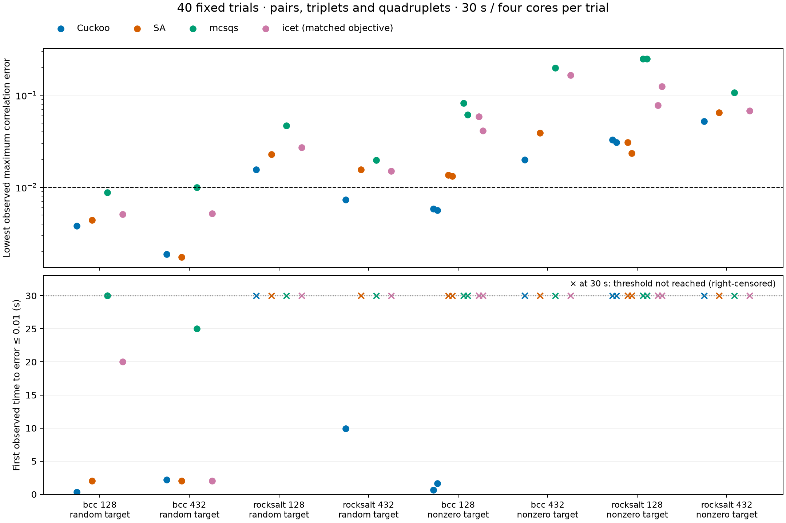

# m_scraps

**Multi-sublattice SCRAPS** generates alloy and ceramic supercells with
specified chemical short-range order and pair, triplet, and quadruplet
correlations. It extends [SCRAPS / Hybrid-Cuckoo-Search](https://github.com/DuaneDJohnson/Hybrid-Cuckoo-Search)
(Super-Cell Random APproximates) with per-pair, per-shell Warren–Cowley targets,
independently constrained sublattices, and a decorated-correlation objective.

Formerly named `scraps-perpair`. Existing `scraps-*` commands, Python imports,
INPUT keywords, and output filenames remain compatible. The new primary CLI
is `m_scraps`; upstream attribution is retained in [Credits](#credits).

## Start here

- [Install](#install-and-build) and use the Python API or guided CLI.
- [Generate diboride, MAX and Heusler cells](notebooks/07_generate_multisublattice.ipynb).
- [Analyze structures and SRO](notebooks/06_structure_analysis.ipynb).
- [Bound attainable pair-SRO error](#bound-attainable-pair-sro-error) before a search.
- [Certify a small-cell minimum](#enumerate-small-cells-exactly) by exhaustive enumeration.
- [Reproduce the benchmark](#reproducing-the-submission-benchmark) without external engines.
- [Check independently against ATAT](#independent-atat-checks), offline or live.
- [Technical overview](docs/OVERVIEW.md) and [contributing](CONTRIBUTING.md).
- Citation metadata: [CITATION.cff](CITATION.cff); see [upstream credits](#credits).

## What's new vs upstream

The following capabilities extend the original
[SCRAPS implementation at commit `6593cae`](https://github.com/DuaneDJohnson/Hybrid-Cuckoo-Search/tree/6593caed501ae8b6bd3a4b7c13c7f549d650d4a7).
They are additions to this software, not claims that the underlying established
methods are new algorithms. The original hybrid cuckoo-search engine remains
attributed to its authors.

### Scientific capabilities

- **Explicit per-pair, per-shell SRO targets:** specify distinct Warren–Cowley
  parameters for individual species pairs through the `SRO` INPUT keyword,
  without editing the optimizer source.
- **Multi-sublattice capabilities:** independently constrain allowed species
  and compositions, including fixed and disordered sublattices. The figure
  backend also supports shared species across sublattices with explicit local
  `COUNTS`; the legacy SRO backend requires disjoint species sets. Examples
  include diborides, MAX phases with disorder on both M and A sites, and Heusler
  intermetallics.
- **Higher-order correlation targeting:** optimize symmetry-resolved decorated
  pairs, triplets, and quadruplets with the optional figure backend. This
  complements the Warren–Cowley pair objective. Exporting new figure definitions
  requires optional icet; bundled figure fixtures can be used without it.
- **Alternative solvers and search controls:** select simulated annealing with
  `MC_KERNEL sa`, Metropolis acceptance, and exponential cooling controlled by
  `SA_T_INITIAL` and `SA_T_FINAL`. It operates within the same outer search loop
  as the default cuckoo MC kernel. Parallel tempering (`MC_KERNEL pt`), compound
  atom swaps, targeted proposals, and warm starts provide additional search
  options; their availability does not establish a performance advantage.
- **Independent structure analysis:** evaluate Warren–Cowley SRO and decorated
  cluster correlations for supplied structures, with supplied reference geometry
  and figure definitions where needed, independently of running the optimizer.

### Performance, workflows, and validation

- Incremental objective updates recompute contributions affected by a swap
  instead of the full objective; full recomputation remains a correctness reference.
- Wyckoff-orbit detection, composition/cell-size feasibility checks, ASE
  integration, Python APIs, and CLI workflows support structure preparation.
- Deterministic seeds, convergence logs, and timed figure checkpoints support
  reproducible comparisons.
- Frozen ATAT references and optional live comparisons provide independent
  validation. The bounded four-method benchmark uses common correlation-error
  and time-to-threshold metrics, with explicit sampling and timing limitations.
- Parser and objective fixes, packaging, regression tests, notebooks, and CI
  improve reliability and usability. These are engineering improvements rather
  than separate scientific-method claims.

See the [changelog](CHANGELOG.md) for release history and the
[benchmark protocol](#reproducing-the-submission-benchmark) for measured results.

## Install and build

From the checkout, install the Python package with `python -m pip install .`.
This compiles the native optimizer and installs the `m_scraps` command and
Python API. Install system MPI, Eigen, CMake and a C++17 compiler first. For
example, macOS uses `brew install open-mpi eigen cmake`; Ubuntu uses
`sudo apt install libopenmpi-dev openmpi-bin libeigen3-dev cmake g++`.
Use a virtual environment and set `MPICXX`/`MPIRUN` together when overriding MPI.
The locally built wheel links against system MPI and is not a portable binary
for arbitrary machines. No package has been published to PyPI yet.

The existing checkout installer is also supported:


Requires a working MPI compiler, Eigen headers, and a C++17 (or newer)
compiler. Clone [rarroyave/m_scraps](https://github.com/rarroyave/m_scraps) and
run the installer from the checkout. On macOS with Homebrew:

```bash
brew install eigen open-mpi
./install.sh
```

The installer discovers the Homebrew prefix, selects matching `mpic++` and
`mpirun` binaries, builds the C++ core, creates an isolated Python environment
from `tools/requirements-lock.txt`, and installs stable commands under
`~/.local/bin`: `m_scraps` (the guided CLI), `scraps-wizard`, `scraps-run`, `scraps-verify`, and
`scraps-htp`. Set `MPICXX`, `MPIRUN`, or `EIGEN_INC` explicitly to override
auto-detection. This avoids accidentally pairing Anaconda's MPICH launcher with
a Homebrew Open MPI build.

Native executable: `SCRAPs/m_scraps`; `SCRAPs/scraps` remains available for
compatibility. Start the guided CLI with `m_scraps --help`.

Run the complete regression suite with `./scripts/test.sh -q`. MPI needs local
socket access, so restricted execution sandboxes may need to permit local MPI
communication. Store production sweeps and optimizer outputs outside Git under
`~/runs/scraps-perpair` and run long jobs durably on the Mac Studio.

### Launching: use the matching `mpirun`

PATH-resolved `mpirun` is wrong when multiple MPI installations are
present (a common case on macOS: anaconda ships MPICH's Hydra `mpirun`
and ends up in `$PATH` ahead of Homebrew's Open MPI). Launching an
Open-MPI-built `scraps` with MPICH's Hydra `mpirun` (or vice versa)
silently falls back to **singleton mode**: each process believes it is
the lone rank 0, the four "ranks" can't communicate, each does an
independent search, and only one rank's output survives. SCRAPS now
detects this and prints a loud warning at startup, but the cleanest
fix is to launch with the matching mpirun:

```bash
/opt/homebrew/bin/mpirun -np 4 SCRAPs/scraps     # macOS Homebrew
```

The installed launchers, `tools/run_sqs.py`, and the pytest suite auto-resolve the right
`mpirun` by looking for it next to the `mpic++` from `build.sh`
(controlled by the `MPICXX` env var) before falling back to PATH.

## INPUT file format

All upstream keywords are unchanged. New directives:

```
SRO  <species_i>  <species_j>  <shell_index>  <alpha_target>

AUTO_MCSTEP          <k>          # MCSTEP = max(50, k * N) once N is known
EARLY_STOP_PATIENCE  <n>          # stop after n outer iters w/o improvement
EARLY_STOP_TOL       <tol>        # improvement threshold (default 1e-6)
SPECTATOR_BASIS_SPECIES  <bi>  <s>   # see HEB section below
```

`SRO`: species indices are 0-based and follow the order in `ELEMENT`.
Shell index is 0-based (0 = nearest-neighbor). Lines may appear in any
order; entries are symmetrized automatically (α_ij = α_ji). Pairs not
mentioned default to α = 0.

`AUTO_MCSTEP`: convenient way to scale MCSTEP with supercell size; the
factor `k=7` is what we use in the cell-size benchmarks. Overrides any
explicit `MCSTEP` line when set to a positive integer.

`EARLY_STOP_PATIENCE`: stop the optimization once the global best
fitness has not improved by more than `EARLY_STOP_TOL` for that many
consecutive outer iterations. Default 0 = disabled (run to TOTALIter).
Use `patience=3` for typical SQS runs; `patience=5` for harder cases
where you want a few extra iterations to confirm a plateau.

`MC_KERNEL`, `SA_T_INITIAL`, `SA_T_FINAL`: MC kernel selector.
- `MC_KERNEL cuckoo` (default) uses the upstream-derived greedy +
  ε-band acceptance inside a cuckoo-search population.
- `MC_KERNEL sa` uses simulated annealing with Metropolis acceptance
  (`exp(-ΔE/T)`) inside the same outer cuckoo-search loop. The
  temperature decays exponentially from `SA_T_INITIAL` (default 2.0)
  to `SA_T_FINAL` (default 1e-3) across the `TOTALIter` outer
  iterations. Useful for benchmarking and for problems where you
  want the "standard" SA contract; on the test cases we measured
  (SQS, B2/L1₂/L1₀/D0₃/L1₁/L2₁ ordered targets, cell sizes ≤ 500)
  cuckoo and SA reach the same final fitness — neither escapes the
  L2₁ cold-start plateau, which appears to require cluster moves
  or parallel tempering.

`FAST_SWAPS`, `TARGETED_SWAPS`, `TARGETED_SWAP_PROB`: MC-loop tuning.
- `FAST_SWAPS 1` (default) uses the delta-fitness MC path: maintain
  `pairGr` as state across swaps and apply an O(z) delta per proposal
  instead of recomputing the full O(N·z) fitness. 2-18× speedup on
  loop-bound cases, identical convergence to legacy. Set 0 for the
  legacy full-recompute path (kept for A/B comparison).
- `TARGETED_SWAPS 1` biases swap proposals toward the species pair
  (i, j, shell k) with the largest residual², instead of always
  uniform-random atom pairs. Off by default: on the test cases we
  measured (binary/ternary SQS, B2/L1₂/L1₀/D0₃/L1₁ ordered targets,
  cell sizes up to n=500) uniform-random already converges fast and
  the bias adds overhead without speedup. May help on very large
  supercells or complex multi-pair SRO targets where uniform random
  struggles to find improving swaps. `TARGETED_SWAP_PROB <0.0-1.0>`
  controls the bias level (default 0.7 = 70% targeted, 30% uniform
  for exploration).

`RNG_SEED`, `RANDOM_ONLY`, `CONVERGENCE_LOG`: reproducibility and
ablation knobs.
- `RNG_SEED <n>` sets the RNG; per-rank seeds are derived as `n XOR
  (rank * phi64)` so multi-MPI runs are decorrelated yet reproducible.
  Default 0 = use `std::random_device` (non-reproducible).
- `RANDOM_ONLY 1` skips the MC loop entirely and returns the best of
  the initial random nest pool — useful for measuring how much the
  cuckoo-search MC is actually improving over pure random search.
- `CONVERGENCE_LOG <path>` writes per-iteration best-fitness on rank 0
  as a CSV (`iteration, best_fitness, wall_seconds`). Iteration `-1`
  is the pre-MC random-pool best.

See `docs/baseline_vs_scraps.sh` for a runnable comparison that pins
the same seed for RANDOM_ONLY and full SCRAPS and reports the gap.
Our own runs show: SCRAPS reduces fitness by ~12× vs random baseline
on infeasible-SQS plateaus and finds ordered targets (B2, L1_2, etc.)
that are mathematically unreachable by random search at any budget.

### Example — NiCoCr with literature CSRO pattern

```
TYP     3
GITER   1000
ELEMENT 36 36 36
Cell_DIM        3 3 3
NESTS   24
MCSTEP  750
TOTALIter 10
MAXSHELLNUM 2
WEIGHT 2.0 1.0 1.0

# Species: 0=Ni, 1=Co, 2=Cr
SRO 0 2 0 -0.10
SRO 1 2 0 -0.05
```

This produces a 108-atom FCC supercell with α(Ni-Cr) ≈ −0.10, α(Co-Cr) ≈
−0.05, α(Ni-Co) ≈ 0, and α(Cr-Cr) ≈ +0.15 (which emerges naturally from
the sum rule Σ_j c_j α_ij = 0).

## Optimizing pairs, triplets, and quadruplets

An opt-in decorated-figure backend optimizes symmetry-resolved cluster
correlations in the native C++ search. The legacy Warren–Cowley pair objective
and defaults remain unchanged when `FIGURES_FILE` is absent. The exporter
supports independently constrained sublattices, shared species, fixed spectators, and
pair/triplet/quadruplet cutoffs. `SRO` and `TARGETED_SWAPS` are rejected in
figure mode. The submission benchmark below compares single- and multi-sublattice performance using the same decorated correlations.

Install the optional preprocessor in the Python environment used for SCRAPs:

```bash
python -m pip install 'icet==4.0'
```

```python
from ase.build import bulk
from scraps_ase import run_sqs_from_atoms

sqs = run_sqs_from_atoms(
    bulk("Cu", "fcc", a=3.6, cubic=True),
    species=["Ni", "Cu"], element_counts=[16, 16], cell_dim=(2, 2, 2),
    figure_cutoffs=[4.0, 3.0, 3.0],  # maximum diameter in Å: pair, triplet, quadruplet
    figure_objective="weighted_l1", figure_wd=1.0, figure_wn=0.5,
    auto_budget=1, rng_seed=42, ranks=4, work_dir="weighted_figures",
)
```

The CLI accepts `--figure-cutoffs 4.0,3.0,3.0` together with `--species Ni,Cu`,
`--figure-objective`,
`--figure-wd`, `--figure-wn`, `--figure-wr`, and `--figure-tol`.
For two disordered sublattices, pass the same `sublattices` partition as in
pair mode. Concentrations are normalized separately on each sublattice;
within- and cross-sublattice pairs, triplets and quadruplets are included:

```python
carbonitride = run_sqs_from_atoms(
    bulk("NaCl", "rocksalt", a=4.5),  # two-site primitive cell
    species=["Ti", "Zr", "Hf", "C", "N"],
    element_counts=[4, 3, 1, 6, 2], cell_dim=(2, 2, 2),
    sublattices=[(0, [0], [0, 1, 2]), (1, [1], [3, 4])],
    figure_cutoffs=[4.0, 4.0, 4.0], figure_wd=1.0, figure_wn=0.5,
    auto_budget=1, rng_seed=42, ranks=4, work_dir="carbonitride_figures",
)
```

For an AlB₂ primitive ordered as metal, B, B, use
`spectator_basis_species=[(1, boron_species_index), (2, boron_species_index)]`.
Without explicit local counts, the B count must equal the number of fixed sites. Pure sublattices can also
be declared with a single allowed species. Fixed sites have no nonconstant
chemical point functions: icet omits redundant spectator-containing figures,
while retaining every fixed site's geometry and occupation. Thus a geometric
metal–metal–B triplet does not become an independent chemical triplet target.
The total number of species may exceed five. Every search move preserves the
local composition and every fixed occupation.

To allow the same element on multiple sublattices, supply a fourth tuple member
with local integer counts, aligned with that group's species indices. Supply
counts on every group; their sums plus fixed spectator occupations must equal
`element_counts`. This extension requires figure mode. For example, a B2 cell
with Fe-rich and Al-rich sublattices can use:

```python
from ase import Atoms

b2 = Atoms("FeAl", scaled_positions=[[0, 0, 0], [0.5, 0.5, 0.5]],
           cell=[2.9, 2.9, 2.9], pbc=True)
sqs = run_sqs_from_atoms(
    b2, species=["Fe", "Al"], element_counts=[8, 8], cell_dim=(2, 2, 2),
    sublattices=[(0, [0], [0, 1], [6, 2]), (1, [1], [0, 1], [2, 6])],
    figure_cutoffs=[4.2, 4.2, 4.2], figure_wd=1.0, figure_wn=0.5,
    auto_budget=1, rng_seed=42, ranks=4, work_dir="b2_shared_species",
)
```

The corresponding INPUT lines are
`SUBLATTICE 0 BASIS 0 SPECIES 0 1 COUNTS 6 2` and
`SUBLATTICE 1 BASIS 1 SPECIES 0 1 COUNTS 2 6`. Declared groups remain distinct
in the symmetry enumeration even when their allowed elements are identical.
Their correlation targets use local fractions, rather than the global 50:50
composition. The original three-member tuples remain supported for disjoint
species sets. Legacy Warren–Cowley pair mode still requires disjoint species.

The CLI accepts `--sublattices partition.json --cell-dim 2,2,2` with figure
mode; the JSON is a list such as `[[0,[0],[0,1,2]],[1,[1],[3,4]]]`.
Shared-species groups include counts: `[[0,[0],[0,1],[6,2]],[1,[1],[0,1],[2,6]]]`.
Here `--composition` supplies **global** fractions in `--species` order,
and explicit dimensions determine the cell instead of `--target-atoms`.
For this example use `--composition 0.25,0.1875,0.0625,0.375,0.125`.
The existing `--spectator-basis-species` CLI uses active-site fractions;
use pure groups in the JSON instead when combining pure and disordered groups.

These weights are exploratory settings, not property-calibrated defaults.
For a figure with order $n_\alpha$ and maximum intersite distance $d_\alpha$,

$$w_\alpha = \exp(-w_d d_\alpha/d_0)\,w_n^{n_\alpha-2},\qquad
F_{L1}=\frac{\sum_\alpha w_\alpha|\Pi_\alpha-\Pi_\alpha^*|}{\sum_\alpha w_\alpha}.$$

Here $d_0$ is the smallest included diameter (the NN distance when NN pairs
are included). Decay applies to **pairs as well as higher-order figures**.
`FIGURE_WD > 0` penalizes long range; `0 < FIGURE_WN < 1` penalizes higher
order. Normalization is global across decorated components, not separately
by order: the number of components therefore still matters. Orbit
multiplicity enters the average defining each correlation, not an extra
objective weight. Targets use independent random-site concentration moments,
which can be nonzero for asymmetric compositions. Finite fixed-composition
and periodically aliased figures need not attain those targets exactly.

For direct INPUT use (the Python API generates these lines and `FIGURES`):

| Keyword | Default | Meaning |
| --- | --- | --- |
| `FIGURES_FILE path` | absent | Enable native figure objective using exported incidence/basis data |
| `FIGURE_OBJECTIVE weighted_l1\|atat` | `weighted_l1` | Normalized weighted absolute error, or ATAT 3.52 objective |
| `FIGURE_WD value` | `0` | Nonnegative diameter decay |
| `FIGURE_WN value` | `1` | Order multiplier, strictly positive and at most 1 |
| `FIGURE_WR value` | `1` | Nonnegative exact-match-range reward, ATAT mode only |
| `FIGURE_TOL value` | `0.001` | Nonnegative match tolerance (also used in final residual report) |
| `FIGURE_CHECKPOINT_SECONDS seconds` | `0` | Atomic per-rank best-structure snapshots; 0 disables |

`FIGURE_CHECKPOINT_SECONDS seconds` enables atomic per-rank best-figure snapshots
(`FIGURE_CHECKPOINT.rankN.json`), containing occupations, correlations and objective
score. Default 0 disables output; positive finite values specify the minimum
interval between snapshots at proposal boundaries. Requires `FIGURES_FILE`.
Snapshots preserve the search RNG and annealing schedule; they are assessable
structures, not restart state. Benchmark readers must timestamp observation,
including startup, and retain snapshots observed before their deadline.

`atat` follows the mcsqs 3.52 objective's order-coupled matching ranges and
weighted residual subset; it is not simply `weighted_l1` minus one range.
Its source uses a `0.001` near-zero threshold on the **unnormalized** weighted
residual sum and returns `-FLT_MAX` below that threshold. Strong distance
decay can therefore yield the sentinel even with sizable correlation errors.
For compatibility this behavior is retained. It never alone certifies a
match: inspect `FIGURE_CORRELATIONS.csv` and the separately reported maximum
residual. `weighted_l1` avoids this sentinel and normalizes weights stably.
See the [ATAT objective documentation](https://axelvandewalle.github.io/www-avdw/atat/manual/node49.html).

`FIGURES.json` records the exported basis, targets, geometry, and icet
metadata. `FIGURE_CORRELATIONS.csv` contains final per-component errors;
`FIGURE_OCCUPATIONS.txt` records final species indices in native lattice
order for independent verification. `FAST_SWAPS 1` updates only affected
figures; `FAST_SWAPS 0` recomputes them as a correctness reference. Cuckoo,
SA, PT, compound swaps, and MPI final selection all use the chosen objective.
Negative scores do not trigger legacy zero-error termination; configured
iteration/plateau limits remain applicable.

## Picking Cell_DIM: feasibility and a one-shot wrapper

For SQS targets (α=0) the expected pair count `N_i · z_k · N_j / N`
must be integer for every weighted shell, or the optimizer plateaus at
a non-zero fitness floor (see `docs/mcsqs_comparison.md` for the full
explanation). Two tools help:

```bash
# Tell me the best Cell_DIM near 200 atoms for 35:35:30 ternary
tools/suggest_cell.py POSCAR --composition 0.35,0.35,0.30 \
    --target-atoms 200 --shells 2 --non-cubic

# One-shot: pick cell, write INPUT, run scraps with early stopping
tools/run_sqs.py POSCAR --composition 0.35,0.35,0.30 \
    --target-atoms 200 --shells 2 --patience 3
```

`run_sqs.py` composes `suggest_cell.py` with the new INPUT heuristics
(`AUTO_MCSTEP`, `EARLY_STOP_PATIENCE`) so that "give me an SQS at this
composition" is a single command — no manual MCSTEP or TOTALIter
tuning. SCRAPS' main loop also prints a warning at startup if the
chosen `(ELEMENT, Cell_DIM, MAXSHELLNUM)` makes any target
non-integer, naming the offending pair and the floor.

## Quick start (one-command CLI)

For first-time users, `tools/scraps_wizard.py` orchestrates the whole
workflow behind a single command:

```bash
# Single-sublattice equiatomic NiCoCr SQS, target ~100 atoms
python3 tools/scraps_wizard.py quick --template fcc \
    --composition Ni:0.33,Co:0.33,Cr:0.34 --target-atoms 100

# Rocksalt HEA-carbide (Mo,Nb,Ta,W)C
python3 tools/scraps_wizard.py quick --template rocksalt \
    --composition Mo:0.25,Nb:0.25,Ta:0.25,W:0.25 \
    --composition C:1.0

# I have my own POSCAR/CIF (e.g. from Materials Project):
python3 tools/scraps_wizard.py from-structure my_perovskite.cif

# Don't know where to start? Step-by-step prompts:
python3 tools/scraps_wizard.py interactive

# See built-in templates:
python3 tools/scraps_wizard.py list-templates
```

The wizard picks an integer-feasible cell from `--target-atoms`, sets
`AUTO_BUDGET=2` (the "thorough" MC profile — no manual tuning),
applies multi-sublattice `SUBLATTICE` blocks when needed, runs SCRAPs,
and exports the result to CIF (or VASP / XYZ via `--format`). Built-in
templates: `fcc`, `bcc`, `b2`, `rocksalt`, `heusler-l21`,
`perovskite-abo3`. For any non-templated structure, `from-structure`
calls `sublattice_detect.py` to auto-identify Wyckoff orbits.

## High-throughput sweeps (HEA composition space)

For HTP exploration — generating many SQS at once across a composition
grid — `tools/scraps_htp.py` builds on the wizard pipeline:

```bash
# Binary alloy: 11 SQS from pure Ni to pure Co
python3 tools/scraps_htp.py linear --template fcc --species Ni,Co \
    --range 0:1 --step 0.1 --target-atoms 100 --output-dir nico_sweep

# Ternary NiCoCr on the Gibbs simplex at resolution 5 (21 compositions)
python3 tools/scraps_htp.py simplex --template fcc --species Ni,Co,Cr \
    --resolution 5 --target-atoms 100 --output-dir nicocr_sweep

# Custom list from CSV (header row = species, each row = composition)
python3 tools/scraps_htp.py list --template fcc \
    --compositions my_comps.csv --output-dir custom_sweep

# Multi-sublattice perovskite, sweep A-site, fix B and O
python3 tools/scraps_htp.py simplex --template perovskite-abo3 \
    --species Ba,Sr,Ca --resolution 4 --fixed 1:Ti:1.0 --fixed 2:O:1.0
```

Each composition gets its own subdir (e.g. `Ni0.50_Co0.50/`) with the
POSCAR, INPUT, SCRAPS.vasp, sqs.cif, and a per-composition `meta.json`;
the top-level `manifest.json` summarizes everything (cell sizes,
fitness, max\|α\|, wall times). `--workers N` runs N compositions in
parallel; the runner is resumable (re-running skips compositions whose
`sqs.cif` already exists), so a long sweep can be interrupted with
Ctrl-C and resumed later.

## Tutorials

Five end-to-end Jupyter notebooks under `notebooks/`:

1. **`01_first_scraps_run.ipynb`** — shortest path from "I have an ASE
   primitive cell" to "I have a NiCoCr SQS supercell".
2. **`02_targeting_csro.ipynb`** — per-pair SRO targets reproducing a
   literature-style CSRO pattern on NiCoCr, with a random-SQS baseline
   to compare against.
3. **`03_heb_end_to_end.ipynb`** — AlB₂-type high-entropy diboride with
   the boron spectator sublattice, using `suggest_cell.py` to pick the
   cell and `verify_sro.py --spectator-species B` to validate.
4. **`04_multi_sublattice.ipynb`** — (Ni,Co)(Ti,Zr) B2 SQS + CSRO,
   plus `sublattice_detect.py` end-to-end on a Heusler L2₁ POSCAR.
5. **`05_troubleshooting.ipynb`** — common failure modes with
   diagnoses (integer-feasibility floors, multi-shell weighting,
   multi-sub uniformity checks, SCRAPs-vs-mcsqs differences).

See `notebooks/README.md` for a use-case → notebook map. Generated
programmatically from `notebooks/build_notebooks.py`; regenerate with
`python3 notebooks/build_notebooks.py` and `jupyter nbconvert
--execute --inplace notebooks/*.ipynb`.

## ASE interoperability

For users in the ASE ecosystem (`ase`-based workflows, MD codes,
DFT frontends, etc.), `tools/scraps_ase.py` is a thin wrapper that
lets you stay in ASE Atoms-land end to end:

```python
from ase.build import bulk
from scraps_ase import run_sqs_from_atoms

# Start with an ASE primitive cell (any way you like; ase.build, ase.io.read, ...)
primitive = bulk("Cu", "fcc", a=3.6, cubic=True)

# Run SCRAPS and get a SQS as an ASE Atoms back
sqs = run_sqs_from_atoms(
    primitive,
    species=["Ni", "Co", "Cr"],         # symbols matching ELEMENT order
    element_counts=[36, 36, 36],        # exact integer occupation
    cell_dim=(3, 3, 3),                 # supercell tiling
    max_shellnum=2, weights=[1, 1],
    rng_seed=42,
)
print(sqs)                              # standard ASE Atoms
sqs.write("ni_co_cr_sqs.cif")           # ASE I/O
print(sqs.info["scraps_final_fitness"]) # 0 -> exact SQS

# For ordered targets, pass sro_targets=[(i, j, shell, alpha), ...]:
b2 = run_sqs_from_atoms(
    bulk("Cu", "bcc", a=3.0, cubic=True),
    species=["Cu", "Zn"],
    element_counts=[16, 16],
    cell_dim=(2, 2, 4),
    max_shellnum=2,
    sro_targets=[(0, 1, 0, -1.0), (0, 1, 1, +1.0)],  # B2/CsCl
)
```

Two lower-level helpers are also exported:
- `read_scraps_output(path, species=[...])` -- read SCRAPS.vasp into
  an ASE Atoms with proper species relabeling (SCRAPS' output POSCAR
  lacks a species line, so you supply the list).
- `make_scraps_inputs(work_dir, atoms, element_counts, cell_dim, ...)`
  -- generate POSCAR + INPUT from an ASE Atoms primitive; useful when
  you want to launch scraps yourself (e.g. from a job script) instead
  of via the wrapper.

## Verification

`tools/verify_sro.py` computes the Warren-Cowley α matrix directly from
any `SCRAPS.vasp` using pymatgen — independent of SCRAPS's own
accounting, so it serves as a cross-check. Supports multi-shell
computation, target-file comparison with pass/fail tolerance, JSON
output for CI, and POSCAR formats including species symbol lines,
selective dynamics, and non-orthogonal cells.

```bash
pip install pymatgen
python3 tools/verify_sro.py SCRAPS.vasp --species Ni,Co,Cr
python3 tools/verify_sro.py SCRAPS.vasp --species Ni,Co,Cr --target INPUT
```

See [`tools/README.md`](tools/README.md) for the full CLI reference.

After the printtoscreen fix, the SCRAPS log and `verify_sro.py` agree
to floating-point precision.

## Tests

```bash
pytest tools/tests/                  # exercise verifier against known structures
```

Reference cells with analytically-known α matrices (B2 NiAl, L1₂ Ni₃Al)
plus SCRAPS round-trip checks.

The `tests/` directory also ships three case files (INPUT + POSCAR only
— run each in its own directory to produce `SCRAPS.vasp`):

- `tests/bcc_binary/` — binary A_27 B_27 in 3×3×3 BCC, no SRO target.
  Reproduces upstream's `test_bcc` case as a regression check.
- `tests/nicocr_random/` — equiatomic FCC NiCoCr, no SRO. Produces an
  exact SQS (every α = 0.0000).
- `tests/nicocr_csro/` — same composition with the literature-pattern
  CSRO above.
- `tests/fluorite_unsupported/` — **intentionally rejected case.**
  Fluorite-like 96-atom binary supercell with non-uniform sublattice
  coordination (cation z=8, anion z=4). Should exit with code 1 in
  ~1 second after the multi-sublattice diagnostic; verifies the
  detection in `Lattice::coordination_per_shell()` is wired correctly.
  See `tests/fluorite_unsupported/README.md`.
- `tests/heb_5metal_random/` — AlB₂-type 150-atom supercell of
  (Hf,Zr,Ti,Ta,Nb)B₂ with boron declared as the spectator sublattice.
  Optimizer finds an exact SQS on the M sublattice (α = 0 for every
  pair). Demonstrates `SPECTATOR_BASIS_SPECIES` end-to-end.
- `tests/heb_5metal_csro/` — same structure with literature-flavored
  CSRO targets (Hf-Zr clustering +0.30, Hf-Ti ordering −0.30, Ti-Ta
  ordering −0.30, Ta-Nb clustering +0.30). Optimizer achieves ±0.333
  (closest integer-count approximation at this size); unspecified
  pairs stay at α=0. Demonstrates per-pair targeting on a designed
  sublattice with a fixed spectator.
- `tests/heb_5metal_csro_1200/` — same CSRO targets at 1200 atoms
  (10×10×4 supercell). Achieves α ≈ ±0.302 — within 1% of target.
  Demonstrates precision improvement at MLIP-friendly cell sizes,
  with the required `MCSTEP=5000` and shell-focused `WEIGHT` recipe.
- `tests/heb_5metal_nonequi/` — Hf-rich (Hf₅₀Zr₃₀Ti₃₀Ta₂₀Nb₁₄)B₂ at
  432 atoms. Validates that per-sublattice c_j^M reference is computed
  correctly for non-equiatomic M-sublattice compositions; expected α
  matrix is exactly symmetric with α(Nb-X) ≈ −0.029 reflecting Nb
  being the rarest species.

## Supported lattice types

The Warren-Cowley formulation that SCRAPS implements assumes a
**uniform geometric reference** — every atom in the supercell sees
the same coordination structure in each neighbor shell, even if the
chemistry on different sites differs. Two clearly-defined regimes:

### Supported: single-Bravais-lattice-with-basis structures

Lattices where the basis may contain multiple Wyckoff positions, but
all positions share the same nearest-neighbor coordination. This
covers nearly all standard substitutional-alloy contexts:

- Pure FCC, BCC, HCP (ideal c/a)
- Ordered intermetallics with uniform coordination: **B2** (CsCl, e.g.
  NiAl), **L1₂** (Cu₃Au, e.g. Ni₃Al), **D0₃** (Fe₃Al), **B19′** in
  most regimes
- Any random or partially-ordered solid solution on FCC/BCC/HCP

For these, the Warren-Cowley α_ij = 1 − P(j|i)/c_j defined against the
global concentration c_j is the right reference, and SCRAPS computes
it correctly. The validated test cases (`tests/bcc_binary`,
`tests/nicocr_random`, `tests/nicocr_csro`, plus the pytest reference
structures B2 NiAl and L1₂ Ni₃Al) all fall in this regime.

### Supported: one designed sublattice + one or more spectator sublattices

Structures where compositional disorder is confined to a single
sublattice and other sublattices are occupied by a single fixed
species. The canonical example is the **AlB₂-type high-entropy
diboride (HEB)**, where 4–6 transition metals share the metal
sublattice and pure boron sits on a fixed honeycomb sublattice.
Also covers:

- HEB family: (Hf, Zr, Ti, Ta, Nb, Cr, Mo, W, V) on M with pure B
- Carbides and nitrides of similar structure (high-entropy MX_n)
- Substitutional alloys with structural vacancies pinned to specific
  sites
- Any structure where the user can identify which basis positions
  belong to the compositionally-disordered (designed) sublattice

Use the `SPECTATOR_BASIS_SPECIES <basis_idx> <species_idx>` INPUT
keyword to declare which basis positions are spectator (one line per
spectator basis position). For an HEB with M at POSCAR basis 0 and B
at basis positions 1, 2 (with B as species 5):

```
SPECTATOR_BASIS_SPECIES 1 5
SPECTATOR_BASIS_SPECIES 2 5
```

The optimizer pins those positions to the declared species and only
shuffles atoms on the designed (non-spectator) sublattice. Warren-
Cowley α is computed using per-sublattice reference concentrations
c_j^M = N_j^M / N^M (M = non-spectator atoms) and counting only
M-M neighbor pairs. Output α matrix omits spectator-species rows and
columns. See `tests/heb_5metal_random/` and `tests/heb_5metal_csro/`.

A practical note on shell numbering: in HEB-type lattices, the global
shell ordering puts B-B and M-B distances before the first M-M shell.
Set `MAXSHELLNUM` large enough to reach the M-M shells (≥ 8–10 for
AlB₂-type with typical c/a ≈ 1.1), or your fitness function won't
include them.

#### MLIP-friendly cells: WEIGHT and MCSTEP scaling

When you go beyond a few hundred atoms to MLIP-friendly cell sizes
(≥ ~1000), two parameters need attention:

1. **MCSTEP and GITER should scale roughly with N.** The Cuckoo
   Search inner loop attempts a fixed number of single-site swaps
   regardless of cell size, so at large N the per-atom swap budget
   drops and the optimizer leaves you near random init. Empirical
   guideline: `MCSTEP = GITER ≈ 10 × N_metal_atoms`. For a 400-M-atom
   HEB, use ~5000 each instead of the default 500.

2. **WEIGHT must focus on the targeted shell when multiple M-M
   shells exist.** In a small HEB cell (e.g. 5×5×2 = 50 M atoms with
   cutoff = c = 1.1) only one M-M shell fits inside the cutoff. In
   larger cells (10×10×4 = 400 M atoms with cutoff = 4.4) several
   M-M shells fit. With `WEIGHT 1 1 1 …` the optimizer puts equal
   pressure on every shell, including the untargeted ones, which
   pulls back toward SQS. Set `WEIGHT 0 0 … 1 … 0 0` with `1` only
   at the index of your targeted shell. See
   `tests/heb_5metal_csro_1200/README.md` for the concrete recipe.

With these two tuned, 1200-atom HEB CSRO targeting hits α to ±0.002
in ~25 seconds on 4 ranks.

### Supported: multi-sublattice structures with disjoint species per sublattice

**New in v0.4.0.** Structures with two or more chemically-disordered
sublattices where each species belongs to exactly one sublattice:

- **Rocksalt HEA-carbides / nitrides**: 4–6 transition metals on the
  metal sublattice, C or N on the anion sublattice.
- **Full Heusler (L2₁) with independent X, Y, Z mixing**: e.g.
  designed quaternary Heuslers with chemical disorder on multiple
  Wyckoff orbits simultaneously.
- **Double perovskites / spinels** with cation site mixing on two
  Wyckoff positions.

Use the `SUBLATTICE` INPUT keyword:

```
SUBLATTICE <id> BASIS <b1> <b2> ... SPECIES <s1> <s2> ...
```

Each block declares which basis positions and which global species
indices belong to that sublattice. Species and basis positions must
be disjoint across sublattices; with disjoint species,
`pairGr[i][j][shell]` and `targetSROpair[i][j][shell]` naturally
distinguish intra- and cross-sublattice pairs without a new
dimension. Cross-sublattice pair counts are determined by composition
and the optimizer leaves them alone; intra-sublattice pair counts are
optimized via swap moves gated to stay within each sublattice.

For automatic Wyckoff-orbit detection from a POSCAR (the standard
crystallographic partition), run:

```bash
python3 tools/sublattice_detect.py POSCAR --write INPUT
```

This appends draft `SUBLATTICE` blocks for each Wyckoff orbit with
`<fill in>` SPECIES placeholders — you then edit them to assign
species. See `tools/sublattice_detect.py --help` for `--symprec`
tuning and JSON output.

### Supported: lattices with non-uniform coordination via per-Wyckoff SUBLATTICE (v0.4.2+)

Lattices where different Wyckoff orbits have physically different
coordination numbers (fluorite cation z=8 vs anion z=4; sigma phase
5 orbits with z=12-15; Laves phases; MAX phases) work as long as
each Wyckoff orbit gets its own `SUBLATTICE` block. The uniformity
check applies *within* each sublattice rather than across all atoms,
and the per-sublattice fitness uses the right per-(σ, τ, k)
coordination tensor.

```bash
python3 tools/sublattice_detect.py POSCAR --write INPUT  # auto-detects orbits
```

Without `SUBLATTICE` blocks, the same POSCARs still abort with the
legacy non-uniform-coordination message (the optimizer assumes
single-sublattice uniform z) — see `tests/fluorite_unsupported/`.

For these lattice types, use ATAT's `mcsqs`
(<https://www.brown.edu/Departments/Engineering/Labs/avdw/atat/>),
which supports sublattice-resolved SQS construction natively.

## ATAT-free regression tests and automatic benchmarks

Saved ATAT 3.52 numerical outputs are bundled under `tools/fixtures/atat/`.
No ATAT executable, ATAT source, network access, or icet installation is needed
for these checks:

```bash
bash build.sh
python -m pytest tools/tests/test_atat_reference.py tools/tests/test_reference_benchmark.py -q
```

The suite checks 160 saved ATAT objective values, eight saved `corrdump`
correlation vectors for independently disordered rocksalt and fixed-boron
diboride cells, native incremental swaps, and analytical shared-species B2
random targets. Hashes protect the frozen corpus. ATAT's terminal score is
explicitly tested separately from all-components correlation convergence.
The native objective probe needs a C++17 compiler; end-to-end optimization
also needs the SCRAPs binary and a matching MPI launcher.

After the tests pass, benchmark current SCRAPs without launching ATAT:

```bash
python tools/benchmark_atat_reference.py \
  --output "$HOME/runs/scraps-perpair/reference-benchmark-001" \
  --trials 5 --seconds 60 --ranks 4
```

Use a new output directory for each run. Defaults cover FCC binary 32,
BCC ternary 54, rocksalt ternary/binary 16, fixed-B diboride 24, and shared
Fe/Al B2 16 sites. `--cases fcc_binary_32 bcc_ternary_54` selects a subset;
`--profile atat_default` selects uniform weighting (default: geometric decay).
All cases optimize pairs, triplets, and quadruplets. Each trial uses repeated
finite SCRAPs searches at the requested rank count with fixed seeds and a wall-clock cap.

Outputs include `provenance.json`, `summary.json`, `historical-comparison.json`,
and per-trial inputs, logs, structures, correlations, and `result.json`.
Time-to-target uses maximum absolute correlation-error thresholds of 0.05,
0.025, 0.01, and 0.001, plus weighted absolute-error thresholds. Unreached
thresholds remain right-censored at the budget, including trials with no
completed structure. Medians include these trials; a null median means fewer
than half reached the target. Times refer to observed completed outputs,
not unrecorded intermediate search states. These are numerical tolerances,
not calibrated property-error tolerances.

Fixture unpacking/model loading, search, and independent assessment are timed
separately. Search includes MPI startup, initialization, repeated input
loading, and optimization. Original cluster generation is excluded because
this benchmark uses frozen inputs. Archived mcsqs quality data cover only
the two single-sublattice cases and are a frozen partial-campaign snapshot
from a four-core Mac Studio M1 Max run. Reports flag core-count mismatches;
comparisons across hosts are historical quality references, not measured
speedup factors. This older frozen corpus has no multi-sublattice mcsqs timing
baselines; the separate submission benchmark below provides a matched comparison.

The **ATAT-free reference benchmark** GitHub Actions workflow runs reference
tests before a short five-case benchmark on relevant pull requests or manual
dispatch. Reports are uploaded as artifacts. CI timings are informational;
correctness failures fail the job, but timing fluctuations and unmet accuracy
thresholds do not. For controlled performance studies, run the same command
on a dedicated host with the same allocated cores and retain its provenance.

## Reproducing the submission benchmark

### Scope and interpretation

This is a **40-trial screening benchmark**, not a universal ranking. It compares
native cuckoo search, native SA, ATAT mcsqs, and icet with a matched ATAT objective
on BCC Nb–Mo–Ta (one disordered sublattice) and rocksalt (Ti,Zr,Hf)(C,N)
(two disordered sublattices), at 128 and 432 sites. Each method receives 30 seconds
and four allocated cores. Seed 20261019 covers all eight structure/size/target
combinations; seed 21261019 repeats only the two 128-site nonzero-target cases.
Targets are random correlations or correlations of an attainable ordering-biased
reference; they are not an exhaustive sweep of SRO strengths.

For every method, let Δᵢ be the achieved minus target correlation for decorated
component i, with K assessed components. The common metrics are:

| Metric | Definition and interpretation |
| --- | --- |
| Lowest error | Minimum observed maxᵢ abs(Δᵢ) within the time budget |
| RMS and mean absolute error | √(Σᵢ Δᵢ²/K) and Σᵢ abs(Δᵢ)/K, evaluated at the selected best-maximum-error structure |
| Time to threshold | First observation at or below 0.05, 0.025, or 0.01 for each error metric, including startup; headline comparisons use maximum absolute error |
| Unreached threshold | Right-censored at 30 seconds; not counted as a successful 30-second attainment |

All methods assess the same decorated pairs, triplets, and quadruplets.
The optimization score is distinct from these correlation errors. Observation
intervals make threshold times upper bounds on internal attainment times.
Limited seeds, discrete finite-cell targets, and host-dependent timings prevent
broad statistical or speedup claims. The icet comparison uses a matched custom
objective, not the stock icet objective. Examples for other materials are not
additional benchmark evidence. Full protocol and rerun instructions follow.


The default workflow requires **neither ATAT nor icet**. The package includes
frozen reference results, figure definitions and checksum-verified regression
fixtures for all 40 trials:

```bash
m_scraps benchmark --report-only --output archived-results
m_scraps benchmark --seconds 5 --ranks 4 --output fresh-results
```

The second command runs both native methods on BCC-128 and rocksalt-128 using
the bundled figures. Select other cases with `--cases`; the archived 30-second
measurements remain clearly separated from fresh measurements. Comparing
execution times across different hosts or budgets does not establish speedup.
Explore the standalone [HTML benchmark report](docs/benchmark_report.html)
(download and open it in a browser), the measured
[results table](docs/submission_benchmark.csv), and the figure below.
Regenerate the HTML report with
`python tools/benchmark/submission/html_report.py`; no external engines are required.



The recorded host was an Apple M1 Max Mac Studio (10 physical CPU cores,
64 GiB RAM), with four cores allocated per trial. All 40 trials produced
ATAT-validated structures. At maximum absolute
correlation error ≤0.01, cuckoo reached the threshold in 5/10 trials and each
other method in 2/10. SA achieved the lowest error on random BCC-432 and on
the two nonzero-target rocksalt-128 repeats; cuckoo achieved the lowest error
on the other problem/seed combinations. This limited screening does not
establish statistical superiority across materials or search settings.

### Optional full four-method rerun


The fixed benchmark in `tools/benchmark/submission/run.py` compares native
cuckoo search, native simulated annealing, ATAT 3.52 `mcsqs`, and the icet 4.0
annealer with an explicitly matched ATAT objective calculator. The icet arm
is **not a benchmark of the stock icet objective**. All arms optimize and
independently assess the same decorated pairs, triplets, and quadruplets.

| Dimension | Fixed selection |
| --- | --- |
| Structures | BCC Nb–Mo–Ta; rocksalt (Ti,Zr,Hf)(C,N) |
| Cell sizes | 128 and 432 sites |
| Targets | Independent-site random; nonzero ordering-biased reference |
| Repetition | Seed 20261019 everywhere; seed 21261019 also on 128-site nonzero targets |
| Budget | 30 seconds, four allocated cores per trial; 40 trials total |
| Objective | ATAT matching-range objective, WD=0, WN=1, WR=1, tolerance=0.001 |

Install the normal Python dependencies and `icet==4.0`, build SCRAPs with
`bash build.sh`, and supply separately installed ATAT 3.52 `mcsqs` and
`corrdump` executables in one directory. No ATAT binaries are bundled.
Run on an otherwise idle machine:

```bash
python tools/benchmark/submission/run.py \
  --output "$HOME/runs/scraps-perpair/submission-001" \
  --atat-bin /path/to/atat/bin
```

`--prepare-only` constructs and independently validates the inputs without
running searches. Repeating the command with the same output directory resumes
completed trials; changes to frozen source, inputs, or executables require a
new directory. There is no automatic matrix expansion. Search allocation is
20 minutes total; input generation and independent assessment add wall time.

The nonzero target contains the exact pair, triplet, and quadruplet correlations
of one saved fixed-composition configuration. That configuration proves
attainability but never initializes a search. Target strengths differ by
chemistry and size; the input artifacts include their directed Warren–Cowley
values. The random targets need not be exactly attainable in a finite cell.

`summary.json` records maximum absolute, RMS, and mean absolute correlation
errors, per-order errors at the best-maximum-error structure, quality curves,
and first-observed passages through 0.05, 0.025, and 0.01. A missing passage is
right-censored at 30 seconds, including trials with no valid output. These
correlation tolerances do not imply a calibrated property error. The ATAT
optimization score and actual correlation errors are reported separately.

Every method includes startup and initialization in its search budget. SCRAPs
uses four MPI ranks; mcsqs and icet use four independent workers. Native
checkpoints are emitted at proposal boundaries at intervals of at least 0.25 s.
Readers observe at 1–10, 15, 20, 25, and 29.98 s; completed native outputs are
also recorded. Availability is the actual read-completion time, and candidates
read after 30 s are excluded. First-observed times are upper bounds, not exact
internal attainment times. No speedup claim should be inferred from the
limited seed sample or from comparisons on different machines.

The output preserves source/input/executable hashes, Python and MPI versions,
all search inputs and logs, independently validated structures, and portable
regression fixtures. Routine CI checks numerical correctness using saved
fixtures; it does not rerun the 40-trial campaign or assert wall-clock speed.

Release history is recorded in the [changelog](CHANGELOG.md).

## Credits and citation

If you use m_scraps in research, please cite **both** the original SCRAPS paper
below and the **Zenodo DOI for the m_scraps release you used**. The frozen
v0.5.1 archive is available at
[doi:10.5281/zenodo.23475896](https://doi.org/10.5281/zenodo.23475896).

> R. Arróyave (2026). *m_scraps: multi-sublattice short-range-order and
> cluster-correlation targeting* (Version 0.5.1) [Computer software]. Zenodo.
> https://doi.org/10.5281/zenodo.23475896

Machine-readable software citation metadata is provided in `CITATION.cff`.

Original SCRAPS / Hybrid-Cuckoo-Search code by Rahul Singh, Aayush Sharma,
Prashant Singh, Ganesh Balasubramanian, and Duane D. Johnson (Iowa State
University / Ames National Laboratory). Please cite their paper if you use
this code:

> R. Singh, A. Sharma, P. Singh, G. Balasubramanian, D. D. Johnson,
> *Accelerating computational modeling and design of high-entropy alloys*,
> Nature Computational Science **1**, 54–61 (2021).
> [doi:10.1038/s43588-020-00006-7](https://doi.org/10.1038/s43588-020-00006-7)

Extension work and bug fixes by Raymundo Arroyave (Texas A&M).

## Release verification

SRO fitness includes the error for absent unlike-species bonds when the target
expects a nonzero count. To target an absent pair, specify `SRO i j shell 1.0`;
omitted targets default to random mixing (`0.0`). This applies to the full,
fast-swap, and simulated-annealing evaluators.

The test suite generates integration structures in temporary directories; no
pre-existing `SCRAPS.vasp` files are required. Run `pytest tools/tests -q -rs`
after building the native optimizer. Install `icet==4.0` to exercise the optional
figure-export tests as well. GitHub CI separately checks core tests without icet,
optional exporters with icet, and clean package installation plus notebooks.
Dependency updates arrive as pull requests; there is no automatic publication
or merge workflow.

## Funding acknowledgment

Development of m_scraps is supported by the U.S. National Science Foundation under Award [OAC-2608825](https://www.nsf.gov/awardsearch/showAward?AWD_ID=2608825) (PhaseForge).

Any opinions, findings, and conclusions or recommendations expressed in this material are those of the author(s) and do not necessarily reflect the views of the National Science Foundation.

We acknowledge support from the Air Force Research Laboratory (AFRL) through ARCTOS Technology Solutions, LLC, under TOPS VI, Task Order 03, subcontract 165852-19F5830-19-02-C1.

## License

Licensed under the [MIT License](LICENSE), preserving the upstream Iowa State
University copyright and the copyright for the m_scraps extensions. Original
authorship and citation guidance are listed above; see also `SCRAPs/ReadMe.md`
and individual source-file headers.

## Analyze an existing structure

`m_scraps analyze` evaluates fully occupied periodic structures without running
an optimizer or requiring ATAT/icet. Standard ASE-readable structures (including
species-labelled POSCAR, CIF and extended XYZ) are accepted.

```bash
m_scraps analyze structure.cif --cutoff 6 --shells 3 \
  --output analysis.json --csv sro.csv
```

The output gives directed pair counts, species-conditioned coordination,
Warren–Cowley SRO, distances and shell coverage. Shells are numbered from one
**separately for each ordered sublattice pair**. The cutoff is in angstrom;
inspect `shell_coverage` and increase it if fewer shells are available than
requested. Periodic images are included even for small cells.

For multi-sublattice materials, supply `--sublattices sublattices.json` with
explicit labels in reference-site order, for example:

```json
{"site_labels": ["M", "M", "A", "A", "C"],
 "allowed": {"M": ["Ti", "Zr"], "A": ["Al", "Si"], "C": ["C"]},
 "counts": {"M": {"Ti": 1, "Zr": 1}, "A": {"Al": 1, "Si": 1}, "C": {"C": 1}}}
```

This illustrates the schema, not a MAX-phase unit cell. Supply one label per
actual site. Counts are optional; forbidden occupations always cause an error.
Without labels, all sites form one sublattice. Fixed sublattices and pairs
involving them are flagged explicitly. SRO uses the concentration on the
**neighbor sublattice**, and the conditional probability uses the observed
number of bonds from the center species. Missing species or bonds produce
JSON `null`, not a fabricated zero.

For relaxed structures, add `--reference ideal_supercell.cif --tolerance 0.2`.
Neighbors and shells then come from the reference geometry; chemical symbols
come from the mapped input sites. Mapping accepts atom reordering and periodic
wrapping but requires cells matching within 0.0001 angstrom (to accommodate
legacy output rounding) and a unique site within the tolerance
(angstrom). It does not fit strain, origin shifts, rotations or vacancies.
Without a reference, shells use actual distances; `--shell-tolerance` controls
the maximum distance width of a shell (default `0.00001` angstrom).

Optional `--targets targets.json` compares selected SRO entries, reporting
signed residuals, maximum absolute error, RMS error and mean absolute error:

```json
[{"source": "M", "destination": "A", "shell": 1,
  "center_species": "Ti", "neighbor_species": "Si", "target": -0.1}]
```

For pair/triplet/quadruplet correlations, supply a native figure file and its
species alphabet in the original index order:

```bash
m_scraps analyze structure.cif --cutoff 6 \
  --figures figures.dat --species Ti,Zr,Al,Si,C --output analysis.json
```

The figure file provides the reference cell, site order, occupational basis,
explicit decorated cluster sums and targets. Its SHA-256 hash and basis are
recorded in the report. Version-3 figure files also supply sublattice groups
and required compositions. Correlation errors use the same evaluator as the
benchmark: maximum absolute error, RMS, mean absolute error, per-order errors
and weighted L1. Defaults `--wd 0 --wn 1` give uniform feature weights; other
weights follow the native diameter/order convention. Preserve the figure file
with the report to reproduce the complete cluster definitions. The evaluator
does not construct new figure sets.

The Python equivalent is:

```python
from ase.io import read
from m_scraps import analyze_structure
report = analyze_structure(read("structure.cif"), cutoff=6, shells=3)
```

See [the materials-analysis notebook](notebooks/06_structure_analysis.ipynb)
for diboride, MAX-211 and Heusler examples with explicit sublattices. These
prototype decorations illustrate analysis and do not establish phase stability.

### Independent ATAT checks

The materials-analysis reference corpus preserves actual ATAT 3.52 `corrdump`
outputs, lattice and cluster files, structures, figure definitions, executable
and source hashes, and expected error metrics. It contains two seeded
configurations each of the diboride, MAX-211 and Heusler examples. Normal tests
read these frozen outputs; they never regenerate expected answers using the
implementation being tested.

Run the comparisons **without ATAT or icet**:

```bash
m_scraps compare-atat --output frozen-comparison.json
```

If ATAT is installed, rerun the independent calculations yourself:

```bash
m_scraps compare-atat --corrdump /path/to/atat/bin/corrdump \
  --output live-comparison.json
```

This compares the live ATAT output both to the frozen reference and to the
current m_scraps evaluator. It checks every cluster correlation, aggregate
error metrics, and the covered SRO entries. Exit status is 1 for a numerical
disagreement (default absolute tolerance `2e-10`), 2 for invalid inputs or an
execution failure, and 0 when all comparisons pass. Results include the actual
ATAT executable hash. Temporary ATAT working files are isolated from the corpus.
No icet installation is needed for this replay.

You can also analyze your own decoration of one of the supplied reference cells:

```bash
m_scraps compare-atat --case max211 --structure my_max211.cif \
  --corrdump /path/to/atat/bin/corrdump --output my-comparison.json
```

The cell, allowed occupations and per-sublattice compositions must match the
selected case. Atom order may differ; small internal relaxations are mapped to
reference sites. This compares ATAT and m_scraps on **your occupations**, rather
than expecting your correlations to equal those of a bundled configuration.
It is not an automatic reference generator for arbitrary new lattice types.

The three new SRO reference cases have binary equiatomic mixed sublattices.
With ATAT point values gamma = -1,+1, their SRO follows
`alpha_ab = -gamma(a)*gamma(b)*<gamma_i gamma_j>`. Pair orbits at the same distance
and sublattice pair are combined using orbit multiplicities. Fixed-site pairs
are checked analytically rather than presented as nontrivial ATAT correlations.
General multicomponent SRO requires the full basis inversion; the binary
conversion is not applied to ternary sublattices. Existing ternary fixtures
independently test the decorated correlations themselves.

Maintainers can deliberately recapture these fixtures with the opt-in
`tools/benchmark/capture_analysis_oracle.py` generator (ATAT 3.52 and icet 4.0
required). Ordinary CI must consume the reviewed fixtures, not overwrite them.


## Bound attainable pair-SRO error

`m_scraps bounds` calculates a necessary lower bound for a specified set of
Warren–Cowley SRO targets at fixed cell geometry and composition. It runs no
optimization and requires neither ATAT nor icet. Supply a fully occupied cell;
its species counts define the composition to preserve. The same cell provides
a valid witness and therefore an achieved **upper bound** on the optimum.

```bash
m_scraps bounds structure.cif --cutoff 6 --shells 3 \
  --targets targets.json --sublattices sublattices.json \
  --metric max_error --output bounds.json
```

Omit `--sublattices` for a single-sublattice system. Sublattice JSON uses the
same `site_labels`, `allowed`, and optional `counts` schema as `analyze`.
Targets use chemical symbols and **one-based shells per ordered sublattice pair**:

```json
[{"source": "all", "destination": "all", "shell": 1,
  "center_species": "Cu", "neighbor_species": "Zn", "target": -0.1}]
```

Use your actual sublattice labels instead of `all` when supplying sublattices.
Only the explicitly listed components contribute, with equal weights; omitted
components are not implicitly targeted at zero. Choose `max_error`, `rms_error`,
or `mean_absolute_error`; all three are included in the JSON. Python users can
call `m_scraps.sro_bounds(atoms, cutoff=6, targets=targets, ...)`.

For each component, write α = 1 − n/D, where n is the directed integer pair
count and D = Nᵢ z(σ→τ) cⱼ(τ). The target requests n* = D(1 − α*).
If A and B are the source- and destination-species bond capacities among E
shell bonds, necessary count limits are max(0, A+B−E) ≤ n ≤ min(A,B).
Same-species counts within one sublattice must be even because both bond
orientations are retained. The nearest admissible integer count gives a
componentwise error floor; maximum, RMS, and mean absolute floors are formed
from those componentwise bounds. Exact rational quantities are retained in
JSON (for RMS, the exact field stores the squared error).

For example, a 32-site equiatomic BCC cell has D = 16 × 8 × 0.5 = 64 for its
first-shell unlike-species component. A target of −0.1 requests 70.4 bonds;
rounding to 70 gives a component lower bound of 0.00625. This does not establish
that all desired bond counts can coexist in a lattice configuration.

Interpret the output as follows:

- `lower_bound`: no valid decoration satisfying the assumptions can do better.
- `achieved_upper_bound`: error of the supplied structure.
- `optimality_gap`: upper minus lower bound, in the selected metric.
- `status: certified_minimum`: the supplied structure exactly attains the
  rational bound (for RMS, equality is checked on squared errors).
- `status: lower_bound`: a nonzero gap remains. In particular, a zero lower
  bound does **not** prove that the target is attainable.

This first implementation is an **independent pair-count relaxation**. It does
not jointly optimize neighbor totals, reciprocal target components, SRO sum
rules, or full lattice realizability, so its bound can be loose. It supports
shared species across labeled sublattices, but requires uniform coordination
within each requested sublattice-pair shell. Nonuniform cases are rejected;
provide a suitable ideal `--reference` or refine the sublattice partition.
Inspect shell coverage and choose a cutoff containing the shells of interest.

These bounds apply to the stated **SRO-error metrics**, not the native weighted
bond-count fitness or decorated pair/triplet/quadruplet correlation errors.
No claim of a bound on the figure benchmark's error is made.


## Enumerate small cells exactly

`m_scraps enumerate` covers all labeled-site decorations with the specified
cell and per-sublattice compositions, evaluating one representative per verified
symmetry orbit by default. It certifies the minimum
of the **selected pair-SRO metric** only after enumeration finishes. No native
optimizer, ATAT, or icet is needed.

```bash
m_scraps enumerate small_cell.cif --cutoff 6 --shells 3 \
  --targets targets.json --sublattices sublattices.json \
  --metric max_error --max-configurations 100000 --output exact-result
```

The targets, sublattices, reference mapping, shell numbering, and metric options
are the same as [`bounds`](#bound-attainable-pair-sro-error). Omit sublattices
for a single-sublattice cell. Shared species, fixed spectators, and separately
constrained disordered sublattices are supported. As in `bounds`, coordination
must be uniform within each requested sublattice-pair shell. Only explicit SRO
targets contribute, with equal weights; there are no implicit zero targets.

Before enumeration, the command computes the number of configurations as the
product of Nₛ! / ∏ₐ nₛ,ₐ! over sublattices. It refuses to start if that exceeds
`--max-configurations` (default 100000). A 16-site equiatomic binary cell has
12870 labeled-site configurations; a 32-site cell has 601080390. The cap applies
to this full count **before symmetry reduction**, bounding the combinatorial
problem conservatively. The cap does not limit elapsed time: cost also depends
on the number of sites, periodic bonds, and target components.

The output directory must be new. It contains:

- `result.json`: completion status, configuration counts, exact selected error,
  the earlier relaxed bound, certification scope, target residuals, provenance,
  and the best occupations and sublattice labels in evaluation order.
- `best.extxyz`, `best.cif`, and `best.POSCAR`: a witness structure attaining the
  reported error. Extended XYZ and the JSON occupations retain the evaluation
  order; POSCAR is written without species sorting. When `--reference` is
  supplied, the witness uses that reference's geometry and site order.

Comparisons use exact rational arithmetic; RMS is compared through its exact
mean squared error. Decimal JSON fields are numerical presentations. The other
two metrics describe the selected witness, not separate optimized minima.
Ties retain the first best witness, starting with the supplied decoration.

A completed search reports `status: certified_minimum`, with `lower_bound`
equal to `best_error` and zero `optimality_gap`. `relaxed_lower_bound` preserves
the independent pair-count bound so one can see whether lattice constraints
make the true minimum larger.

Optionally set `--max-seconds 30`, which includes preparation time. A time limit
or Ctrl-C during enumeration saves the current witness and reports
`status: best_found`, `complete: false`, the number evaluated, and the gap to
the relaxed bound. The supplied structure is evaluated first so an early stop
still has a witness. The configuration count covers the enumerated sequence;
that initial witness evaluation is recorded separately. With symmetry reduction,
`evaluated_configurations` counts representatives and `covered_configurations`
sums their orbit multiplicities. A completed search requires coverage equal to
`total_configurations`, not that many objective evaluations. No resumable state is
saved. Incomplete searches never claim exhaustive certification.

Python callers can use
`report, witness = m_scraps.enumerate_sro(atoms, cutoff=6, targets=targets, ...)`.
Certification applies only to the specified finite cell, geometry, compositions,
constraints, targets, and selected metric—not other cell sizes or shapes, or
decorated pair/triplet/quadruplet objectives.


### Symmetry reduction and exhaustive reference mode

The default `--symmetry auto` uses
[spglib](https://spglib.readthedocs.io/en/v2.7.0/api/autodoc/spglib.html) to propose
symmetries of the supplied cell, with sites colored by sublattice label rather than initial chemical
occupation. Every accepted operation must preserve each sublattice label and
**exactly preserve the integer directed-bond multiplicities of every requested
shell component**. Thus different target values, directed sublattice-pair
components, shared species, and per-sublattice composition constraints remain
unchanged. Labels and chemical identities are never exchanged, even where a
larger symmetry reduction might be possible.

The search assigns one species subset at a time. It selects one subset per
orbit under the current symmetry group, then continues with the subgroup that
fixes that subset. This avoids constructing every complete decoration. At a
leaf, the orbit multiplicity is the full group order divided by the final
stabilizer order. Summing these multiplicities verifies coverage of the full
combinatorial configuration count.

Use `--symmetry none` for the direct exhaustive reference implementation, or
`symmetry="none"` in Python. `--symprec` controls geometric symmetry detection
(default 0.00001 angstrom); exact bond-graph checks still apply. The result
records the number of verified site permutations and the tolerance. Symmetry
detection failure produces an error rather than an unsupported certificate;
reference mode remains available. The permutation group is capped at 4096
operations to bound symmetry-processing resources.

For a four-site periodic binary ring with two atoms of each species, symmetry
reduces six decorations to two representatives. Tests compare reduced and
exhaustive minima for all three metrics, shared-species multi-sublattice cases,
and distinct target components. Fewer objective evaluations do not guarantee
lower wall time for every small problem: symmetry discovery and orbit handling
also have a cost. This reduction covers only the supplied cell; it does not
enumerate different supercell shapes.
