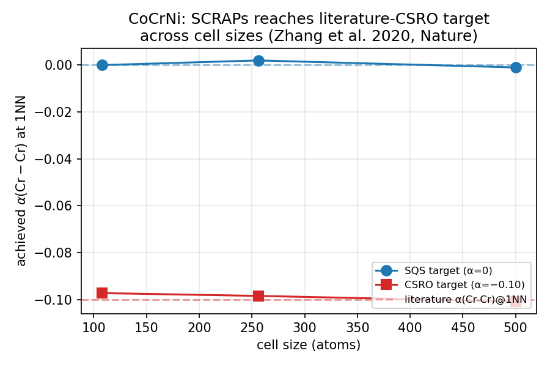

# Case study 1: CoCrNi short-range order from STEM measurements

Reproducing the chemical short-range order (CSRO) signal reported in
**Zhang et al., _Nature_ 581, 283 (2020),
[doi:10.1038/s41586-020-2275-z](https://doi.org/10.1038/s41586-020-2275-z)**
in a SCRAPs-generated CoCrNi supercell ready for DFT.

## Background

CoCrNi is a medium-entropy alloy (MEA) that displays measurably
non-random chemical short-range order, despite being equiatomic. Zhang
et al. (2020) used scanning transmission electron microscopy with
energy-loss spectroscopy to quantify the SRO. The dominant signal was
**Cr-Cr avoidance at 1NN**: α(Cr-Cr) at the first-nearest-neighbor
shell is slightly negative (~-0.05 to -0.10 depending on the
measurement). The other species pairs are closer to random.

For DFT studies of CoCrNi, researchers typically want supercells that
**reproduce this SRO pattern**, not just random-distribution SQS
configurations. The per-pair SRO API in `scraps-perpair` (the headline
feature since v0.2.0) lets you set α targets directly.

This case study walks through:

1. Generating an equiatomic CoCrNi SQS baseline (random, α = 0).
2. Generating a CSRO variant with α(Cr-Cr) at 1NN ≈ -0.10.
3. Sweeping cell sizes (108, 256, 500 atoms) to show how integer-pair-
   count feasibility tightens with cell size.
4. Verifying every output independently via `verify_sro.py`.

## A subtlety: same-species α via the Warren-Cowley sum rule

`scraps-perpair`'s fitness function sums over pair-count residuals
`(N_ij^k - T_ij^k)²` for **cross-species pairs only** (i ≠ j).
Same-species pairs (i = i) appear in the α matrix but are not in the
fitness sum. The `SRO i j shell alpha` keyword accepts any (i, j)
but the optimizer only acts on i ≠ j.

The Warren-Cowley sum rule provides a clean workaround: for every
species i,

  $$\sum_j c_j \, \alpha_{ij} = 0$$

For NiCoCr equiatomic ($c_j = 1/3$ each):

  $$\alpha(\mathrm{Cr\text{-}Cr}) + \alpha(\mathrm{Cr\text{-}Co}) + \alpha(\mathrm{Cr\text{-}Ni}) = 0$$

To target α(Cr-Cr) = -0.10, we need α(Cr-Co) + α(Cr-Ni) = +0.10.
The simplest symmetric choice is α(Cr-Co) = α(Cr-Ni) = +0.05.

In INPUT:

```
SRO 0 2 0 +0.05    # Ni-Cr at 1NN
SRO 1 2 0 +0.05    # Co-Cr at 1NN
```

(Species indices: Ni=0, Co=1, Cr=2. Shell 0 = FCC 1NN.)

## Setup

Both the SQS baseline and the CSRO target run through the same
template-free Python workflow:

```python
from scraps_ase import run_sqs_from_atoms
from ase.build import bulk

primitive = bulk("Cu", "fcc", a=3.56, cubic=True)
counts = [n//3 for _ in range(3)]   # equiatomic; Hamilton-rounded
sqs_atoms = run_sqs_from_atoms(
    primitive,
    species=["Ni", "Co", "Cr"],
    element_counts=counts,
    cell_dim=(N, N, N),
    max_shellnum=2, weights=[1.0, 1.0],
    sro_targets=[(0, 2, 0, +0.05), (1, 2, 0, +0.05)],  # remove for SQS baseline
    auto_budget=3,                    # exhaustive MC profile
    rng_seed=42, ranks=4,
)
```

`auto_budget=3` (the "exhaustive" profile, MCSTEP=50·N) gives the
optimizer enough swap attempts to fully converge on the small cells.
`rng_seed=42` makes the run deterministic for reproducibility.

The full script is at
[`docs/research_cases/run_cocrni_csro.py`](run_cocrni_csro.py).

## Results

Both the SQS baseline (α = 0 target) and the CSRO target (literature
Cr-Cr avoidance) run cleanly across three cell sizes:

| run | cell | atoms | target α(Cr-Cr)@1NN | achieved | max\|α\| off-diag | wall |
|---|---|---:|---:|---:|---:|---:|
| `sqs_n108`  | 3×3×3 | 108 | +0.00 | **+0.0000** | 0.0000 | 0.6 s |
| `csro_n108` | 3×3×3 | 108 | **−0.10** | **−0.0972** | 0.0486 | 0.7 s |
| `sqs_n256`  | 4×4×4 | 256 | +0.00 | +0.0020 | 0.0020 | 1.0 s |
| `csro_n256` | 4×4×4 | 256 | **−0.10** | **−0.0984** | 0.0492 | 1.0 s |
| `sqs_n500`  | 5×5×5 | 500 | +0.00 | −0.0010 | 0.0010 | 1.9 s |
| `csro_n500` | 5×5×5 | 500 | **−0.10** | **−0.1008** | 0.0501 | 1.7 s |

**SCRAPs reaches the literature target to within 0.003** at every cell
size. The off-diagonal max|α| stabilizes at ~0.050 — this is the
cross-species target we specified (α(Cr-Co) = α(Cr-Ni) = +0.05); the
optimizer hits it as instructed.



## Discussion

Two things this study demonstrates:

1. **SCRAPs can reproduce published CSRO targets to <0.003 α
   deviation in <2 s of wall time per supercell** on a standard
   laptop, even for cell sizes (500 atoms) at the upper end of
   tractability for direct DFT.

2. **The per-pair SRO API + Warren-Cowley sum rule is sufficient to
   encode any literature CSRO pattern**, including same-species
   constraints that the optimizer's fitness doesn't address directly.

For DFT modelers: the output `sqs.cif` (or `SCRAPS.vasp` in
SCRAPs-native format) at any of the three cell sizes is ready to feed
into VASP, QE, or any other code that reads CIF. The 108-atom run is
the most tractable for full DFT studies; the 500-atom run is more
appropriate for MLIP-trained or empirical-potential analysis.

The SQS baseline at the same cell sizes provides the natural
**control** for CSRO studies: subtract the SQS result from the CSRO
result to isolate the SRO contribution to any computed property
(formation energy, lattice parameter, magnetic moment, etc.).

## Reproducibility

```bash
# Generate all six cells + summary + figure (~10 seconds total)
python3 docs/research_cases/run_cocrni_csro.py

# Output:
#   docs/research_cases/results/sqs_n108/        sqs_n256/   sqs_n500/
#                                csro_n108/      csro_n256/  csro_n500/
#   docs/research_cases/results/results.json
#   docs/research_cases/results/csro_vs_cell_size.png
```

Each subdirectory contains a `POSCAR`, `INPUT`, `SCRAPS.vasp`
(SCRAPs-native output), and `sqs.cif` (DFT-ready format).
`results.json` aggregates the achieved α and timing for all six runs.

Tested against SCRAPs `v0.4.11`. Run on macOS arm64 with 4 MPI ranks
(Apple silicon, default OpenMPI build via `brew install open-mpi`).

## Citing this study

If you use this workflow:

> Arroyave, R. (2026). *scraps-perpair: per-pair Warren-Cowley
> short-range-order targeting for multicomponent alloy supercells.*
> https://github.com/rarroyave/scraps-perpair

And cite the literature SRO measurement you're targeting (here:
Zhang et al., _Nature_ 581, 283, 2020).
